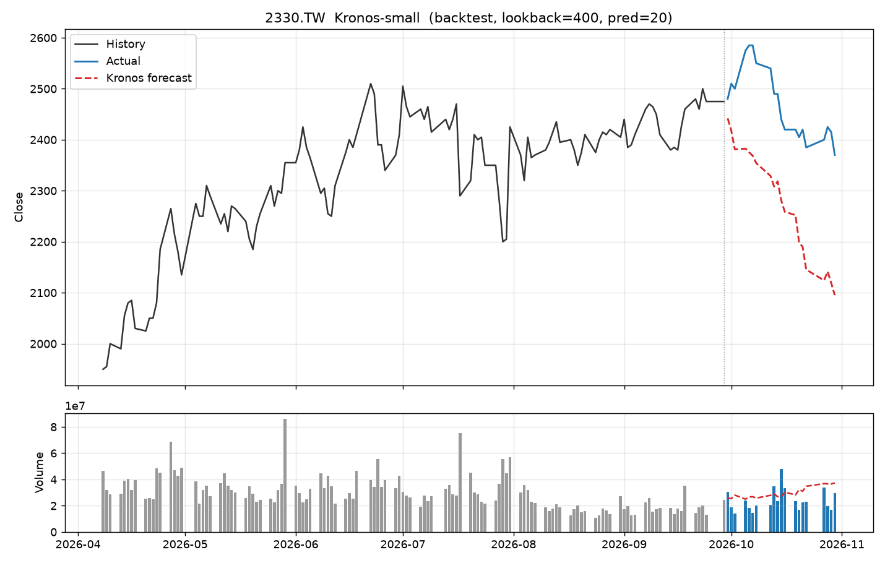
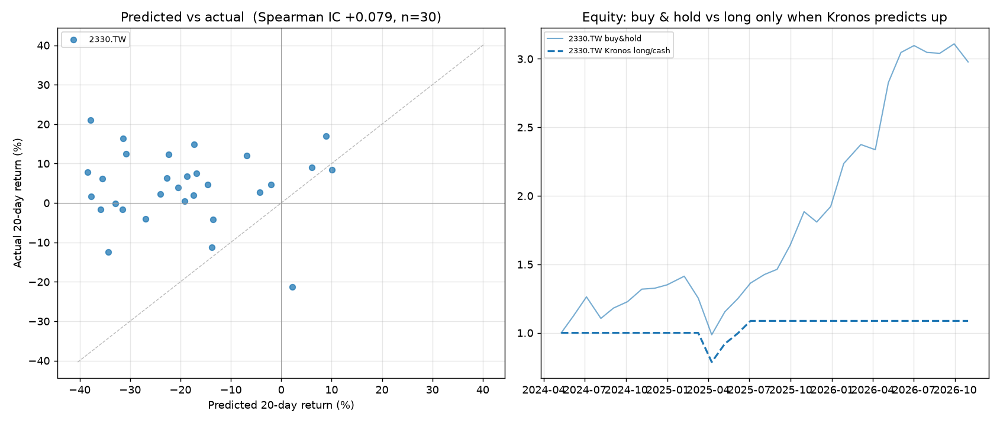

# Kronos 台股預測實驗 (kronos-tw-stock)

用開源金融時序基礎模型 [Kronos](https://github.com/shiyu-coder/Kronos)（MIT License）預測台股日 K，並做滾動回測。

本 repo 只放我自己寫的腳本與結果，**不包含 Kronos 模型原始碼**。

## 使用方式

```bash
git clone https://github.com/shiyu-coder/Kronos.git
cd Kronos
# 把本 repo 的 run_tw_stock.py、rolling_backtest.py 複製到 Kronos 根目錄（與 model/ 同層）
pip install -r requirements.txt
pip install yfinance

python run_tw_stock.py --ticker 2330.TW                                  # 回測模式
python run_tw_stock.py --ticker 2330.TW --mode forecast --pred_len 20    # 預測未來
python rolling_backtest.py                                               # 滾動回測
```

上櫃股票用 `.TWO`，例如 `6488.TWO`。

## 結果範例（台積電 2330，small 模型）

| 單次回測 | 滾動回測 |
|---|---|
|  |  |

滾動回測摘要：`rolling_2330_small_summary.csv`

本專案為個人研究，不構成投資建議。
